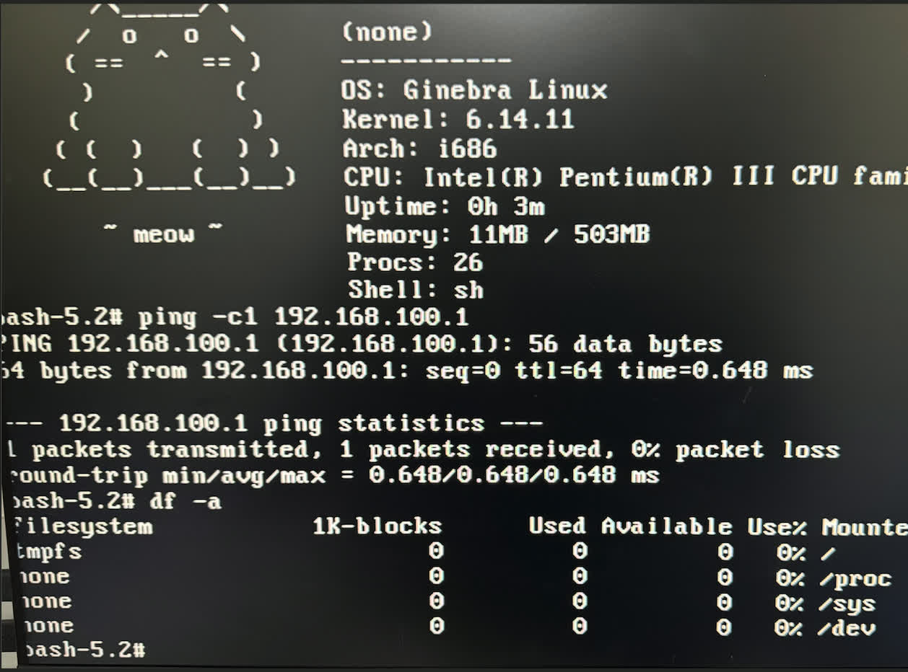

# Ginebra Linux




```
       /\_____/\
      /  o   o  \      A minimalist Linux distribution
     ( ==  ^  == )     that fits on two 1.44MB floppy disks
      )         (
     (           )     ~ meow ~
    ( (  )   (  ) )
   (__(__)___(__)__)
```


**Ginebra Linux** is a fork of [Floppinux](https://github.com/w84death/floppinux) that extends the original concept using **two floppy disks**:

- **Floppy 1 (boot)**: Contains the kernel (`bzImage`) and SYSLINUX
- **Floppy 2 (rootfs)**: ext2 filesystem with BusyBox, kernel modules and network support

The system boots from the first floppy, gives you 30 seconds to swap to the second one, and then copies everything to RAM to run entirely from memory.

## Features

- Linux Kernel 6.14.11 compiled for i486
- BusyBox 1.36.1 (static build with musl)
- Network support: RTL8139 (`8139too`), RTL8139C+ (`8139cp`) and NE2000 PCI, detected automatically, DHCP or static IP
- Loadable kernel modules
- **mia** setup tool: configures, builds and writes the floppies, serves the packages
- **Bali package manager** for installing additional software
- VESA framebuffer (up to 1024x768) and X11 with Xfbdev (TinyX) + dwm
- System runs 100% from RAM after boot
- Ideal for retro hardware or virtual machines

## Requirements

- Linux with `podman` (or `docker`): the build runs inside an Ubuntu 24.04 container, no `sudo` or loop mounts needed
- ~3GB of disk space
- `python3` for `mia`
- `qemu-system-i386` (or `qemu-system-x86_64`) to test

Building without containers also works on Ubuntu 24.04 with the packages listed in `scripts/Containerfile`.

## Project Structure

```
ginebra-linux/
├── config/
│   ├── kernel-6.14.11.config  # Kernel configuration (the one running on the real hardware)
│   └── busybox-1.36.1.config  # BusyBox configuration
├── filesystem/                # Root filesystem (floppy 2)
│   ├── bin/ sbin/ usr/        # BusyBox 1.36.1 (static, musl) + symlinks, bali, ginebrafetch
│   ├── usr/share/udhcpc/      # DHCP client script
│   ├── etc/init.d/rc          # Stage 1 (PID 1): copy to RAM, pivot_root, exec init
│   ├── etc/init.d/rc2         # Stage 2 (sysinit): release floppy, modules
│   ├── etc/init.d/network     # NIC detection, DHCP or static IP
│   ├── etc/ginebra.conf       # System configuration (written by mia)
│   └── welcome                # ASCII banner
├── mia                      # Setup tool (see below)
├── scripts/
│   ├── build.sh               # Build kernel + floppy images in a container
│   ├── build-kernel.sh        # Kernel + modules (runs in the container)
│   ├── build-busybox.sh       # BusyBox (runs in the container)
│   ├── get-toolchain.sh       # i486 musl toolchain (musl.cc)
│   ├── make-floppies.sh       # Floppy images without mounts (runs in the container)
│   ├── run-qemu.sh            # Test on an emulated Pentium III with one floppy drive
│   ├── write-floppy.sh        # Write an image to a real floppy and verify it
│   ├── write-floppy-careful.py  # Track-by-track writer used by write-floppy.sh
│   ├── backup-floppy.py       # Read-only, resumable backup of an old/failing floppy
│   └── Containerfile          # Ubuntu 24.04 build environment
├── repo/                      # Bali package repository
│   ├── build-*.sh             # One build script per package (run by ./mia packages build)
│   ├── src/                   # Sources of Ginebra's own packages (neofetch)
│   └── patches/               # Patches used by the build scripts
├── syslinux.cfg               # Bootloader configuration (floppy 1)
├── bzImage                    # Prebuilt kernel
├── floppy1-boot.img           # Prebuilt boot floppy
└── floppy2-rootfs.img         # Prebuilt rootfs floppy
```

Generated, not versioned: `linux/`, `busybox-1_36_1/`, `i486-linux-musl-cross/` (sources and toolchain),
`dl/` (downloads), `out/` (build output), `mia.conf`, `repo/*.pkg.tar.gz`, `repo/PACKAGES`, `repo/build/`.

## mia: setup tool

`mia` prepares everything to boot Ginebra: it asks how the system should be configured, builds
the kernel, BusyBox, Bali packages and floppy images in a container, serves the Bali repository,
writes the floppies and runs the emulator. It only needs **python3** and **docker or podman**
(works the same on Linux and macOS).

```bash
./mia setup                      # questions: target (fisico/qemu), hostname, DHCP or static IP,
                                 # NIC driver, Bali server  -> mia.conf
./mia build                      # kernel + floppies with that configuration -> out/
./mia packages list              # Bali packages: available build scripts and built ones
./mia packages build less nc     # build packages (or: build all)
./mia packages import DIR        # or import already built *.pkg.tar.gz
./mia serve                      # HTTP server for repo/ in a container (port 8080)
./mia run                        # test in QEMU (Pentium III, one floppy drive)
./mia write disk1 /dev/sdX       # write + verify the real floppies
./mia write disk2 /dev/sdX
./mia status
```

The configuration is baked into floppy 2 as `/etc/ginebra.conf` (the floppies are read-only, so
that is the only persistence: to change it, run `./mia setup` and `./mia build floppies` again):

```sh
HOSTNAME=ginebra
NET_MODE=dhcp            # or static: NET_IP, NET_NETMASK, NET_GATEWAY, NET_DNS
NET_IFACE=eth0
NIC=auto                 # or 8139too, 8139cp, ne2k-pci
BALI_URL=http://192.168.1.10:8080
```

The server is plain HTTP: BusyBox `wget` on the Pentium III doesn't speak HTTPS. Bali reads
`BALI_URL` and only asks for a server when it's empty.

### Network

At boot `/etc/init.d/network` finds the PCI network card and loads its driver:

| Card | Driver |
|------|--------|
| RTL8139/A/B/C/D (PCI revision < 0x20), real cards of the era | `8139too` |
| RTL8139C+ (revision >= 0x20), e.g. QEMU's `rtl8139` | `8139cp` |
| NE2000 PCI (RTL8029, Winbond, VIA...) and any other card with a module | its `modalias` |

Then it configures DHCP (`udhcpc`) or a static IP according to `/etc/ginebra.conf`.

## Building

```bash
scripts/build.sh            # kernel + modules + both floppy images -> out/
scripts/build.sh kernel     # only kernel + modules
scripts/build.sh busybox    # only busybox -> out/busybox
scripts/build.sh floppies   # only the images (after changing filesystem/ or syslinux.cfg)
```

The result:

| File | Contents |
|------|----------|
| `out/floppy1-boot.img` | FAT12, SYSLINUX 4.07, `bzImage` (1,339,904 bytes), `syslinux.cfg` |
| `out/floppy2-rootfs.img` | ext2 (4K blocks, 192 inodes, label `ROOTFS`), `filesystem/` + kernel modules |

### Kernel configuration

`config/kernel-6.14.11.config` is the configuration of the kernel running on the real Pentium III
(build #60, Dec 31 2025). The final `.config` was lost, so it was reconstructed from the original
floppy and validated against the Dec 27 `.config` found in a backup: the result has the same
`bzImage` size (1,319,424 bytes), identical data/bss sections, the same modules and no differing
strings. The remaining ~1.7KB of code comes from a newer Ubuntu gcc revision.

It starts from `tinyconfig` with the options that used to be listed here, plus these corrections:

- **CPU really set to i486**: `scripts/config --enable CONFIG_M486` alone leaves `CONFIG_M686`
  selected; it must also be disabled (`--disable CONFIG_M686`). Modules show `vermagic: ... 486`.
- **Enabled**: `FRAMEBUFFER_CONSOLE` (+ `DETECT_PRIMARY`), VGA 8x8 and 8x16 fonts, `VM86`,
  `ADVISE_SYSCALLS`, `COMPAT_32BIT_TIME`, `I2C=m` (needed by `psmouse`), `FB_SIMPLE=m`
- **Disabled**: `HID`, `VGA_ARB`, `ETHTOOL_NETLINK`, `INET_DIAG`, Intel perf uncore/RAPL/cstate,
  `PCIEASPM`, `PCIEPORTBUS`, `BQL`

No patches: the kernel sources are vanilla 6.14.11.

Changes on top of the original kernel (bzImage 1,339,904 bytes, ~79KB still free on floppy 1):

- `8139CP=m`: driver for RTL8139C+ cards (QEMU's `rtl8139`)
- `PCI_QUIRKS=y`: without it `pci_cache_line_size` is never set and `pci_set_mwi()` fails, so
  `8139cp` (and other drivers using MWI) can't probe on any machine. Also brings the workarounds
  for chipsets of the era (PIIX, VIA, ALi)
- `PACKET=y`: raw sockets, needed by the DHCP client

To change it:

```bash
cd linux && make ARCH=x86 menuconfig && cp .config ../config/kernel-6.14.11.config
```

The boot floppy has ~79KB free next to the kernel: check `out/floppy1-boot.img` still builds.

Modules on floppy 2: `8139too`, `8139cp`, `mii`, `ne2k-pci`, `8390`, `crc16`, `psmouse`, `i2c-core`, `simplefb`.

`CONFIG_SHMEM` is off (as in `tinyconfig`), so the "tmpfs" the system runs from is really ramfs:
it ignores `size=`, can use all the RAM and `df` reports 0 for it.

### BusyBox

`filesystem/bin/busybox` is BusyBox 1.36.1 (vanilla, no patches), static-pie, musl, i486:
497,288 bytes, 75 applets. Its configuration is `config/busybox-1.36.1.config`:

```bash
scripts/build.sh busybox          # -> out/busybox
cp out/busybox filesystem/bin/busybox
```

It uses the musl toolchain from [musl.cc](https://musl.cc/) (`i486-linux-musl-cross`), downloaded
automatically. `crypt` and `/etc/passwd` handling come from musl (`USE_BB_CRYPT` and `USE_BB_PWD_GRP`
are off), `uname -o` reports `GNU/Linux`.

The original busybox of the real floppy (485,000 bytes, 73 applets) is reproduced exactly by this
config without `UDHCPC` and `SHA256SUM`, which were added for DHCP and Bali checksums.

## SYSLINUX Configuration

```
DEFAULT ginebra
PROMPT 1
TIMEOUT 5

LABEL ginebra
KERNEL bzImage
SAY [ GINEBRA LINUX - 30 segundos para cambiar el disco ]
APPEND root=/dev/fd0 rootfstype=ext2 rootdelay=5 ro console=tty0 init=/etc/init.d/rc tsc=unstable vga=ask
```

- `vga=ask` - the kernel stops at *"Press <ENTER> to see video modes..."* and waits 30 seconds:
  **this is the moment to swap to floppy 2**, then press SPACE (text mode) or ENTER to pick a
  graphics mode (see [Graphics](#graphics))
- `root=/dev/fd0 rootfstype=ext2 rootdelay=5` - mount floppy 2 as root
- `ro` - floppy 2 is **never written** (see [Taking care of the floppies](#taking-care-of-the-floppies))
- `init=/etc/init.d/rc` - stage 1 init script

SYSLINUX must be 4.x (4.07): newer versions are too large to fit next to the kernel.

## Boot Process

1. SYSLINUX loads `bzImage` from floppy 1
2. At the `vga=ask` prompt you swap to floppy 2 and press SPACE
3. The kernel mounts floppy 2 **read-only** and runs `/etc/init.d/rc` as PID 1, which:
   mounts `/proc`, `/sys` and a RAM filesystem, copies `/bin /sbin /etc /lib /usr` to RAM,
   `pivot_root`s into it and `exec`s `/sbin/init` **from RAM**
4. BusyBox init runs `/etc/init.d/rc2` (sysinit), which **unmounts the floppy**
   ("Disquete liberado: ya puedes retirarlo"), runs `/etc/init.d/network` (NIC driver,
   DHCP or static IP from `/etc/ginebra.conf`), loads `psmouse` and shows the banner
5. From here on the system runs 100% from RAM; the floppy can be removed

## Graphics

The kernel has `vesafb` built in: `/dev/fb0` only exists if a VESA mode is chosen at boot.
At the `vga=ask` prompt press **ENTER** (instead of SPACE) and type the mode number:

| Mode | Resolution |
|------|------------|
| `311` | 640x480, 16 bits |
| `314` | 800x600, 16 bits |
| `317` | 1024x768, 16 bits |
| `305` / `318` | 1024x768, 8 / 24 bits |

`scan` lists every mode the video card supports. Check it with `fbset` or `dmesg | grep vesafb`.

For X install `xfbdev-full`, `dwm`, `st` and `dmenu` with Bali and run `startx`. In dwm the
modifier is **Alt**: Alt+Shift+Enter opens a terminal (`st`), Alt+p runs `dmenu`, Alt+Shift+c
closes a window, Alt+Shift+q quits.

## Testing with QEMU

```bash
./mia run                           # uses out/, configured by ./mia setup
scripts/run-qemu.sh                 # Pentium III, 32MB, one floppy drive, RTL8139
NIC=ne2k_pci scripts/run-qemu.sh    # use the NE2000 card instead
```

It boots floppy 1 and, at the `vga=ask` prompt, swaps to floppy 2 (inserted write-protected) through
the QEMU monitor, exactly as you would do on the real machine. Press SPACE to continue.

**Network in QEMU:** QEMU's `rtl8139` is an RTL8139**C+**, which needs `8139cp` (the original
system only had `8139too`, used by the real cards). It's detected automatically now; with
`NIC=ne2k_pci scripts/run-qemu.sh` the NE2000 card is used instead. In QEMU the host is
`10.0.2.2`, so the Bali server is `http://10.0.2.2:8080` (`./mia setup` with target `qemu`).

## Writing to Real Floppies

```bash
./mia write disk1 /dev/sdX                                     # USB floppy drive
./mia write disk2 /dev/sdX
# or directly:
sudo scripts/write-floppy.sh out/floppy1-boot.img /dev/sdX
```

The script refuses anything that isn't a 1.44MB removable disk. It writes track by track
(`write-floppy-careful.py`): each track is read back and compared, and sector 0 is re-read to make
sure the head is still on the right cylinder (cheap USB drives lose alignment and write to the
wrong track). Bad tracks are rewritten, and a final pass verifies the whole disk again. If it
still fails, try another floppy.

If the drive keeps resetting (`dmesg` shows USB disconnects), plug it into a rear USB port or a
powered hub: the motor draws more current than some front ports give.

## Taking care of the floppies

The original rootfs floppy was mounted read-write during the whole session: `rc2` couldn't unmount it
because `init` (PID 1) was still running from it. Every boot updated the superblock, and any write,
`sync` or power-off with the motor spinning could leave it half-written. Now:

- Floppy 2 is mounted **read-only** (`ro`) and **unmounted** once the system is in RAM.
  Nothing writes to it, not even `sync`.
- **Slide the write-protect tab** on both floppies after writing them (`write-floppy.sh` reminds you).
  Ginebra boots fine with both disks protected.
- Remove the floppy once you see *"Disquete liberado"*; don't power off while the drive light is on.
- Always verify after writing (`write-floppy.sh` does it) and keep the images: a floppy is a copy, not a backup.
- To rescue an old floppy, use `scripts/backup-floppy.py /dev/sdX disk.img`. It is read-only and resumable,
  and it stops if the drive loses track alignment (worn USB drives do: they start returning data from the
  wrong cylinder). Then replug the drive and run it again.
- Floppies and heads wear: clean the drive head and don't read a failing disk over and over.

## Differences from Original Floppinux

| Feature | Floppinux | Ginebra Linux |
|---------|-----------|---------------|
| Floppies | 1 | 2 |
| Boot filesystem | FAT12 + initramfs | FAT12 (kernel only) |
| Root filesystem | cpio.xz in RAM | ext2 on second floppy |
| Modules | No module support | Extensible |
| Network | No network | RTL8139 and NE2K modules |
| Package manager | None | Bali |
| X11 | None | Xfbdev (TinyX) |

## Bali Package Manager

**Bali** (named after my other cat) is the package manager for Ginebra Linux. It's an interactive shell script that downloads and installs static binaries compiled for i486.

### Features

- Interactive menu-driven interface
- Downloads packages from HTTP server (`BALI_URL`, written to the floppy by `mia`)
- Supports `.pkg.tar.gz` archives (extracts to /) or plain binaries
- Fetches package list from server's `list.txt`
- Minimal footprint (~2KB shell script)

Packages are installed in RAM, so they are gone after a reboot: install them again with `bali`.

### Usage

```bash
# Run bali (interactive)
bali
```

Bali will:
1. Show a banner and use the server in `BALI_URL` (`/etc/ginebra.conf`), or prompt for IP and port
2. Fetch and display available packages from `http://server:port/list.txt`
3. Prompt for packages to install (space-separated names, `a` for all, `q` to quit)
4. Download and install each selected package

```
,-----.          ,--.,--.
|  |) /_  ,--,--.|  |`--'
|  .-.  \' ,-.  ||  |,--.
|  '--' /\ '-'  ||  ||  |
`------'  `--`--'`--'`--'
 Package Manager v0.3

Server: http://192.168.1.10:8080

Fetching package list...

Available packages:
-------------------
  - bash
  - vim
  - htop
  ...

  (a = install all, q = quit)

Packages to install: bash vim
```

### Setting Up a Package Server

```bash
./mia packages build all          # or: ./mia packages import DIR
./mia serve                       # serves repo/ on port 8080 (container)
```

Built packages (`repo/*.pkg.tar.gz`) are not versioned: build them with `./mia packages build`
or import an existing set with `./mia packages import DIR`. `build all` takes a while: `xfbdev`
builds the X libraries first, which `dmenu`, `dwm` and `st` need.

`mia` writes `repo/PACKAGES` (name, version, size, sha256, description) and `repo/list.txt`.
The server URL is written to the floppies by `./mia setup` + `./mia build floppies`.

To add a package, write `repo/build-NAME.sh`: it must leave `repo/NAME.pkg.tar.gz`, a tarball
extracted at `/` on the Pentium III. Everything is static (musl, i486), because there are no
shared libraries on Ginebra; ncurses programs carry their terminal definitions (`--with-fallbacks`)
since there is no terminfo database.

### Available Packages

| Package | Description |
|---------|-------------|
| bash | GNU Bash with readline and history |
| vim | Vi IMproved text editor |
| htop | Interactive process viewer |
| links | Text-based web browser |
| mc | Midnight Commander file manager |
| curl | Command-line HTTP client |
| strace | System call tracer |
| tmux | Terminal multiplexer (prefix Ctrl+b; panes use TERM=xterm) |
| less | File pager |
| nc | Netcat network utility |
| neofetch | System info with Ginebra the cat |
| dropbear | SSH client and server |
| file | File type identifier |
| dmenu | Dynamic menu for X |
| dwm | Dynamic window manager |
| st | Simple terminal for X |
| xfbdev-full | TinyX framebuffer X server, xkb, fonts and `startx` |

### Quick Start

The network is configured at boot (DHCP or static IP, see `/etc/ginebra.conf`), so just run:

```bash
bali
```

### Using Bash

Install `bash` with Bali and run `bash`. Don't point `/etc/inittab` at `/bin/bash`: bash is not
on the floppy (it is installed in RAM after boot), so the consoles would fail to start.

For history support:

```bash
export HOME=/home
export HISTFILE=/home/.bash_history
export HISTSIZE=100
```

## Demo
[Watch Demo](./demo.mp4)

## Credits

- Original project: [Floppinux](https://github.com/w84death/floppinux) by Krzysztof Krystian Jankowski
- Fork: Ginebra Linux (in honor of Ginebra the cat)

## License

CC0 1.0 Universal - Public Domain
